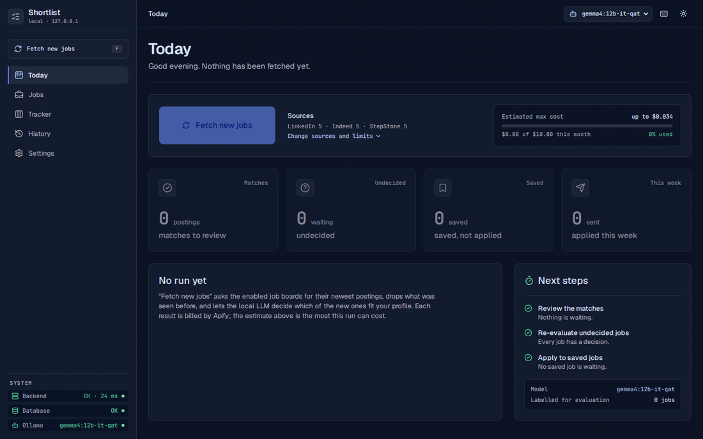
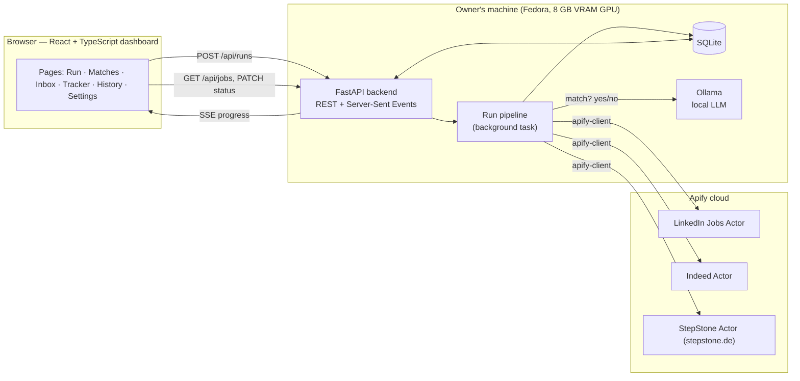
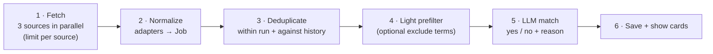
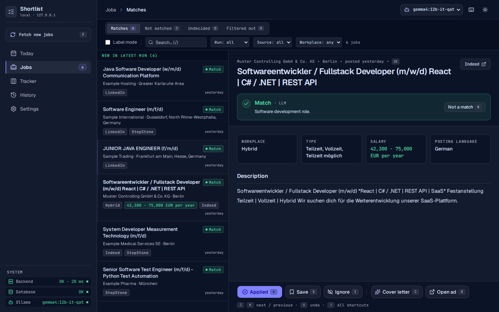
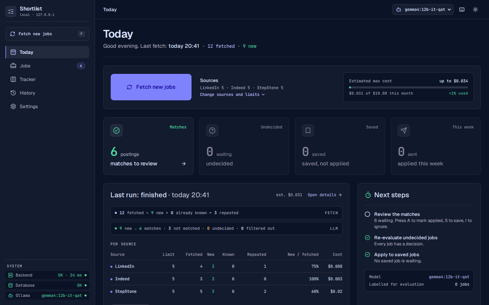
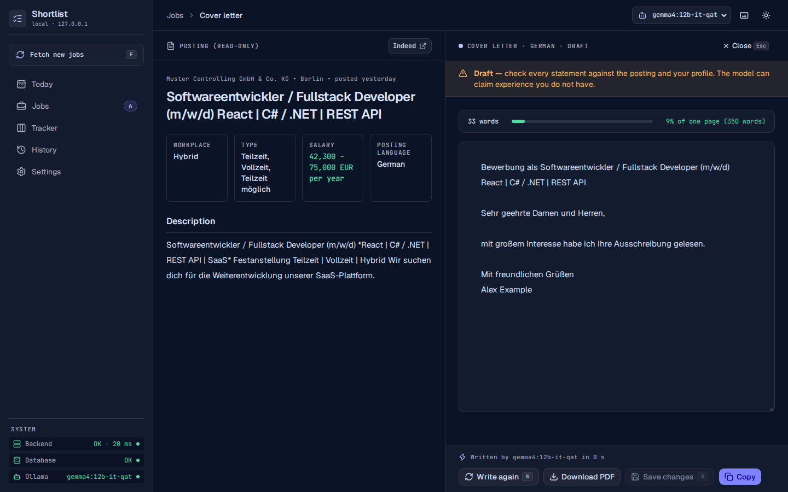

# Shortlist

**Shortlist** turns three job boards into a short list worth reading. It is a local
dashboard opened once a day: one click fetches new jobs from LinkedIn, Indeed and StepStone,
drops everything already seen, and a small LLM on your own GPU decides which of the new jobs
fit your profile — with a one-sentence reason for each. Review them with the keyboard, draft
a cover letter, track the application. Nothing but the job search itself leaves your machine.



The recording and the screenshots show test data with invented companies.

## Architecture



Everything runs on one machine and listens on `127.0.0.1` only. The three job boards are
reached through [Apify](https://apify.com/) Actors; the model runs in
[Ollama](https://ollama.com/). Runs start only when the button is clicked — there is no
schedule.

## How a run works



1. **Fetch.** The three sources run in parallel, each with an explicit result limit and a
   hard charge cap. A source that fails does not stop the others.
2. **Normalize.** One adapter per source turns its output into a common job format: HTML
   stripped, language detected, unknown fields left empty rather than guessed.
3. **Deduplicate.** A fingerprint of company, title and city merges the same job across
   sources and searches, and drops everything fetched in an earlier run. Every fetched item
   is accounted for: new, already known, repeated in this run, or unreadable.
4. **Prefilter.** New jobs with an exclude term in the title (e.g. "Werkstudent") are set
   aside without using the LLM.
5. **LLM match.** Each remaining new job gets one yes/no decision with a reason. Only an
   answer that is exactly the expected JSON is accepted; otherwise the job is "undecided",
   never dropped.
6. **Review.** The matches are a list next to the full posting, with the model's verdict and
   reason on top. `j`/`k` move between jobs, `a` marks one as applied, `s` saves it, `i`
   ignores it, `n` overrules the model; every action can be undone. Rejected, undecided and
   filtered-out jobs are further views of the same list. For a job worth applying to, `c`
   opens a one-page cover letter draft in the language of the posting, next to the ad, to
   edit before sending; it is signed with the name from Settings and downloads as a PDF.







## Measured results

<!-- eval:start -->
| Model | Prompt | Labelled jobs | Accuracy | Precision | Recall | Valid JSON | Median / job | p95 / job | On GPU |
|---|---|---|---|---|---|---|---|---|---|
| `gemma4:12b-it-qat` | v2 | 0 | n/a | n/a | n/a | 100% | 3.4 s | 4.8 s | 87% |
| `qwen3.5:9b` | v2 | 0 | n/a | n/a | n/a | 100% | 1.7 s | 2.4 s | 100% |
| `qwen3.5:9b` | v3-checklist | 0 | n/a | n/a | n/a | 100% | 3.4 s | 4.7 s | 100% |

GPU: NVIDIA GeForce RTX 4060 Laptop GPU. Speed and valid-JSON rate over 29 jobs; accuracy, precision and recall over the labelled jobs only (n/a = no labelled jobs yet).
<!-- eval:end -->

This table is generated from the files in [eval/results/](eval/results/) (`make eval-table`),
and a test fails if the two differ.

**What is measured so far is speed and output validity, not accuracy.** The accuracy columns
compare the model with my own verdicts on jobs (Jobs › Label mode, or saving / applying /
ignoring a job), and no jobs have been labelled yet. The default model,
`gemma4:12b-it-qat`, is therefore my preference rather than a measured winner; any installed
Ollama model can be selected in the dashboard's top bar. See
[docs/decisions.md](docs/decisions.md).

To reproduce: `make eval MODEL=gemma4:12b-it-qat` (add `PROMPT=v3-checklist` for the checklist
prompt, `ALL=1` to include unlabelled jobs for the speed columns).

## Cost

Apify charges per result and, for some Actors, per Actor start. The app estimates the cost
before every run, records it afterwards and warns before a run that could exceed the monthly
budget.

From the run history ([eval/results/apify_costs.json](eval/results/apify_costs.json),
`make costs`): **October 2026 — 5 runs, 55 results, $0.141 estimated.** These were
development runs with a limit of 5 per source; there is no full month of daily use to report
yet. The figure counts only runs started by the app.

One lesson cost real money: a single StepStone run started by hand in the Apify console,
without a result limit, used most of a month's free credit. In the app a run without limits
is not possible.

## Design decisions

- **One adapter per source.** Each Actor has its own input and output; replacing an Actor
  touches one file. Field mappings and what the real output looked like are in
  [docs/actors.md](docs/actors.md).
- **Deduplicate before the LLM.** Only new jobs reach the model, so each job is judged once
  and a second run on the same day costs no GPU time.
- **A small local model.** A yes/no decision with one sentence of reasoning does not need a
  large model, job ads never leave the machine, and there is no per-token bill.
- **Structured output, strictly validated.** Ollama enforces a JSON schema and the answer is
  validated again; anything else is retried once and then marked undecided.
- **Job text is untrusted.** Ads are scraped web content. The prompt marks them as data, the
  only thing accepted back is `{"match": bool, "reason": str}`, and nothing in an ad can
  trigger an action.
- **The owner has the last word.** A verdict on a card overrides the model, and the same
  verdicts are the labels for evaluating it.
- **Designed for the daily session.** The interface follows one design system:
  dark slate surfaces, one indigo
  accent, green for matches and amber for what is undecided, mono type for numbers and keys.
- **Closed to other websites.** The server answers only to `127.0.0.1` / `localhost` and
  refuses API requests that come from another site; see [docs/security.md](docs/security.md).
- **Manual trigger and a cost guard.** No scheduler; every Actor call carries a result limit
  and a charge cap computed from the configured prices.

## Limitations

- It depends on third-party Apify Actors, which can change their output, pricing or
  availability at any time.
- Scraping job boards is subject to each site's terms of use.
- StepStone results contain only a ~300-character snippet, so those decisions are made on
  the title and a few sentences.
- Cover letter drafts can claim experience the profile does not contain, borrowed from the
  job ad; every statement needs checking before sending.
- Small models make mistakes, especially on vague postings; in the first real runs the model
  occasionally read requirements into an ad that it did not state. That is why every card
  shows the reason and can be overridden.
- The same job in two cities is two cards, and city names are matched across languages only
  for a short list of large cities.
- The monthly budget counts the app's own estimates per calendar month, not Apify's billing
  cycle.
- A personal tool for one person on one machine — not a product.

## Setup

Requires [uv](https://docs.astral.sh/uv/), Node.js 24, [pnpm](https://pnpm.io/),
[Ollama](https://ollama.com/) and an [Apify](https://apify.com/) account.

```sh
ollama pull gemma4:12b-it-qat   # the default model; others can be picked in the top bar
cp .env.example .env     # then put your Apify token in it
make install
make start               # dashboard on http://127.0.0.1:8000
```

Then open Settings to enter your name, your own profile and your searches.

## Development

```sh
make dev             # backend with reload + Vite dev server on http://127.0.0.1:5173
make test            # pytest + Vitest (no Apify or Ollama calls)
make e2e             # one Playwright flow against fixture data
make lint            # ruff, mypy, oxlint, tsc
make gen-api-types   # after changing the API: regenerate the TypeScript types
```
